# Outlier Detector: ML API with W&B and Vercel

An API for **training and serving** a detector of atypical trading days on
stock prices. The model is an **Isolation Forest** (scikit-learn) trained on
log returns, volume, the return in excess of the Ibovespa, and a flag for
earnings-release days.

The pipeline is split across three systems:

- **GitHub Actions** runs the CI, trains the models and triggers the deploy.
- **Weights & Biases (W&B)** stores every trained model as a versioned
  artifact, together with its metadata and the metrics of its training run.
- **Vercel** runs the FastAPI application. On startup it downloads the latest
  model of each ticker from W&B into memory. Each request downloads only the
  market data.

## Contents

- [Architecture](#architecture)
- [Pipelines](#pipelines)
- [API](#api)
- [Configuration](#configuration)
- [Running locally](#running-locally)
- [Repository layout](#repository-layout)
- [Maintenance](#maintenance)

## Architecture

### System context

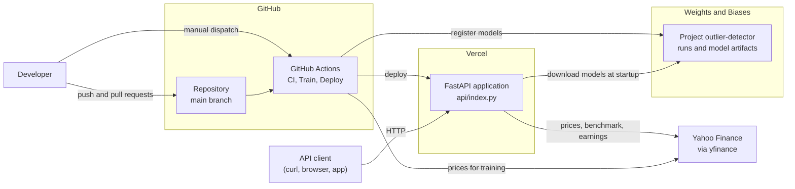

### Package architecture

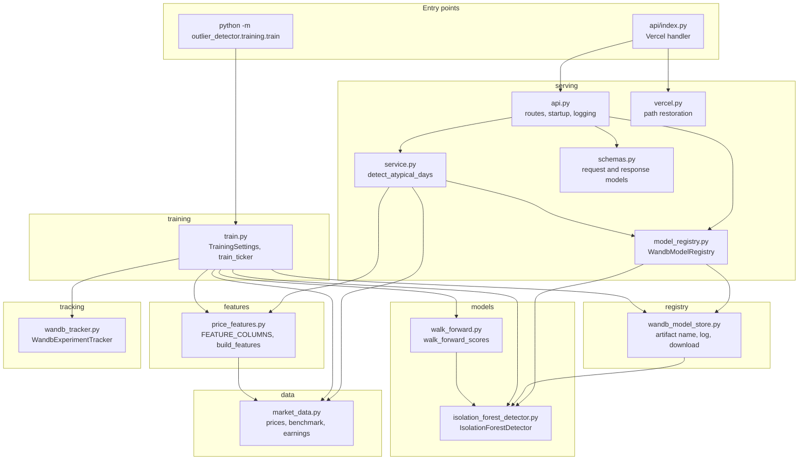

### Components at runtime

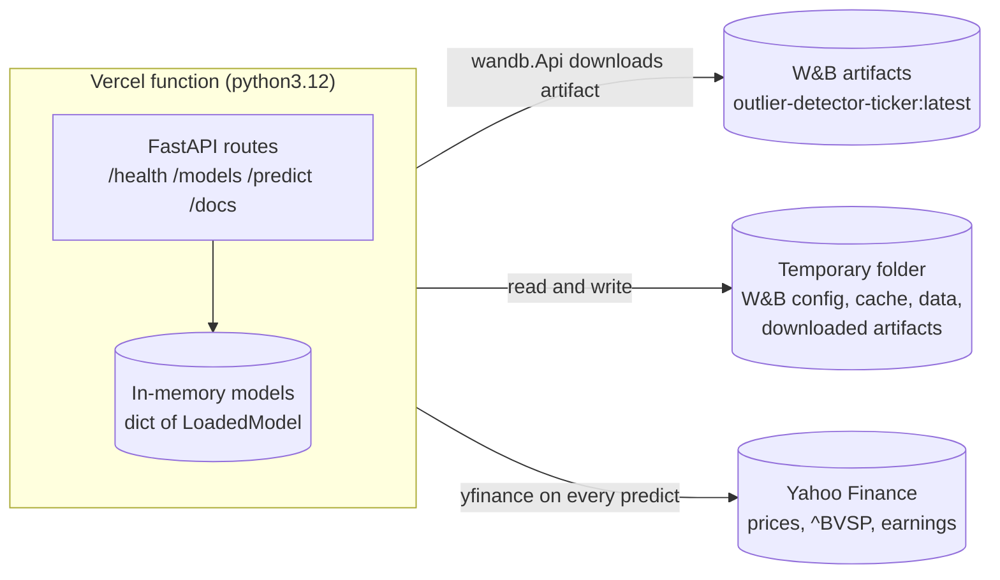

## Pipelines

There are three GitHub Actions workflows. They are independent: the CI runs
on every push, the training is started by hand after the CI of the commit
passes, and the deploy is started by hand with the run id of a successful
training.

### 1. CI: `01 - Continuous Integration`

Runs on every push and pull request. Each job depends on the previous one.

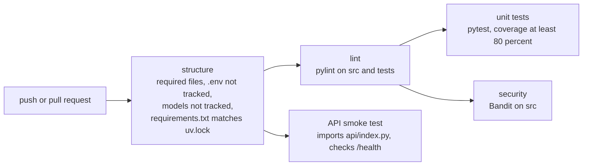

The CI does not need the W&B key. The tests replace the W&B client, and the
smoke test starts the application without `WANDB_API_KEY`.

### 2. Training: `02 - Train Model`

Started by hand, with the inputs `tickers`, `start`, `contamination` and
`random_seed`. Each ticker is one W&B run.

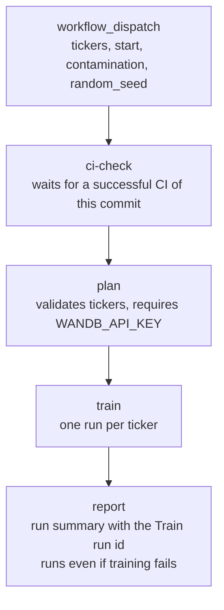

What happens inside `train` for each ticker:

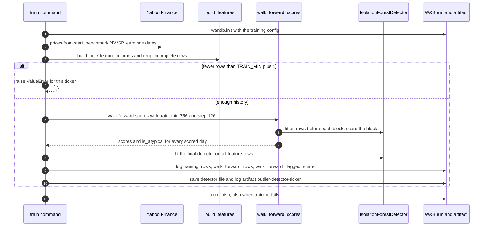

A ticker that fails is counted, and the command exits with code 1 only after
all tickers were tried.

### 3. Deploy: `03 - Deploy API to Vercel`

Started by hand, with the input `train_run_id`.

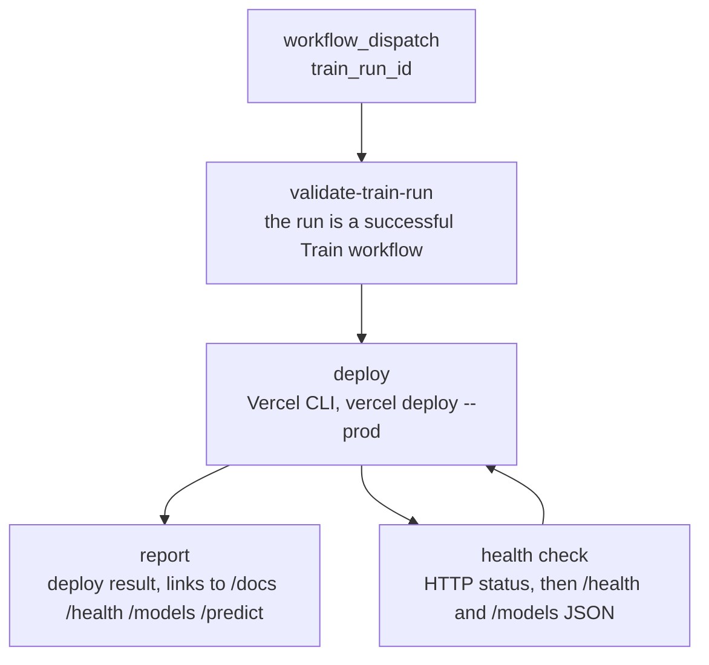

The health check stops at once when Vercel Authentication blocks the public
URL (redirect or HTTP 401/403), and asks to turn off Deployment Protection for
production. Otherwise it retries 30 times until `models_loaded` is at least 1.

### 4. Serving: startup and requests

On startup, `create_app` loads the models into memory. Each request then
downloads only the market data.

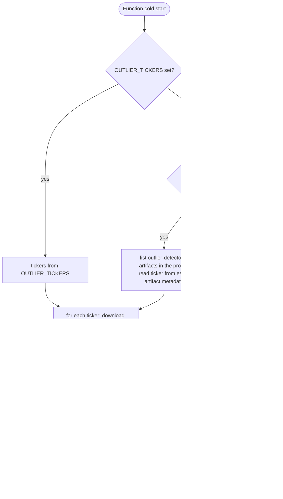

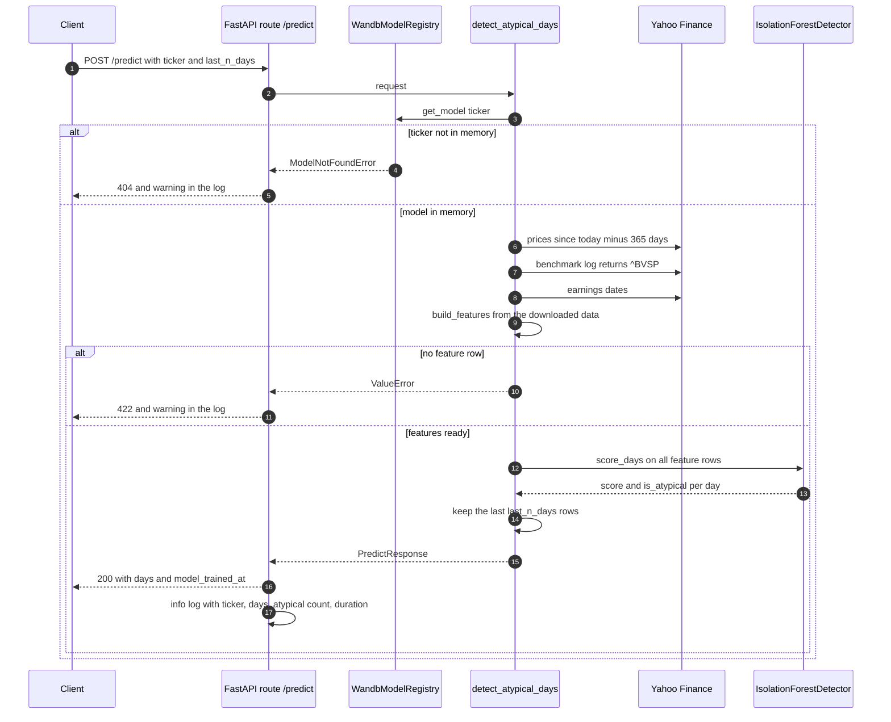

### Request outcomes

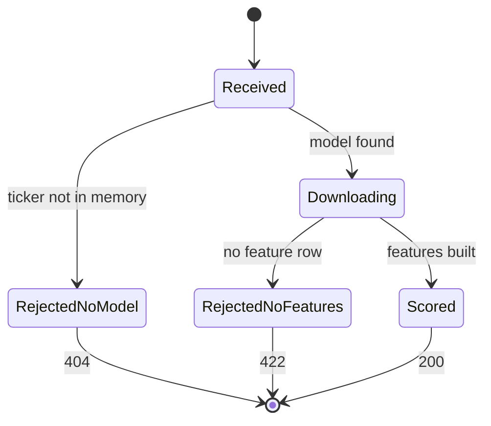

## Model details

### Features

Each row is one trading day, computed only from that day and earlier days.

| Feature | Definition |
|---|---|
| `log_return` | Daily log return of the close |
| `absolute_log_return` | Absolute value of `log_return` |
| `previous_log_return` | `log_return` of the previous day |
| `volatility_20_days` | Standard deviation of `log_return` over 20 days |
| `relative_volume_20_days` | Volume divided by its 20-day average |
| `excess_log_return` | `log_return` minus the log return of the benchmark (`^BVSP`) |
| `is_earnings_day` | 1 when the company published results on that day |

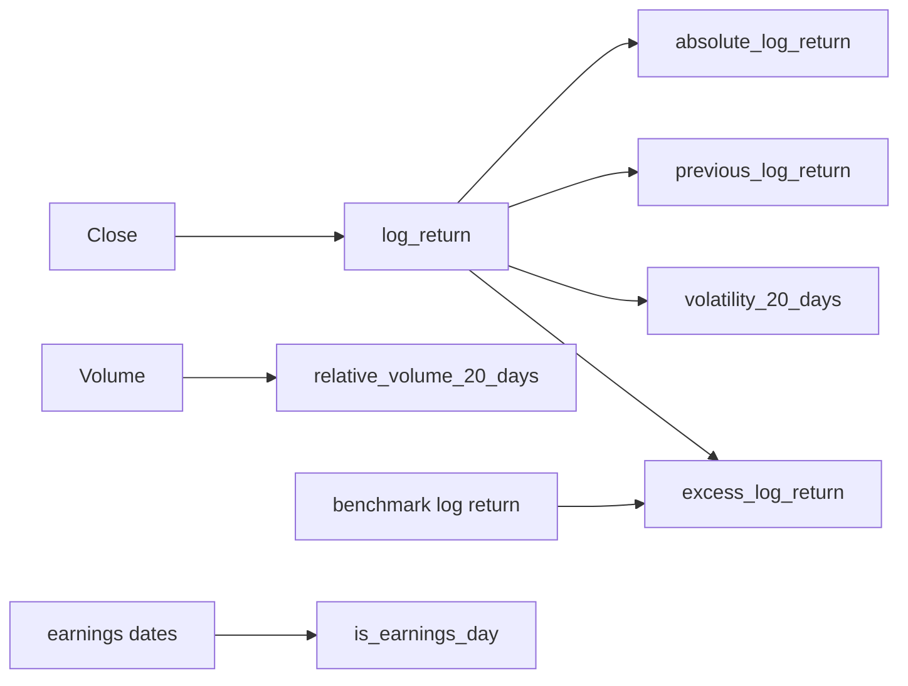

### Walk-forward evaluation

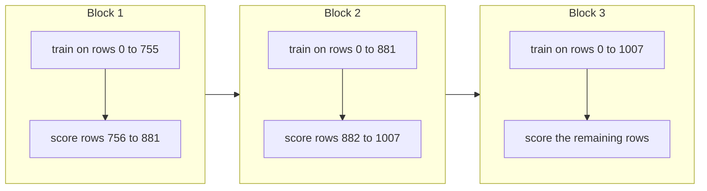

The training window grows and the detector is refitted every 126 rows (`STEP`).
No score uses data that comes after its day.

### Model artifact

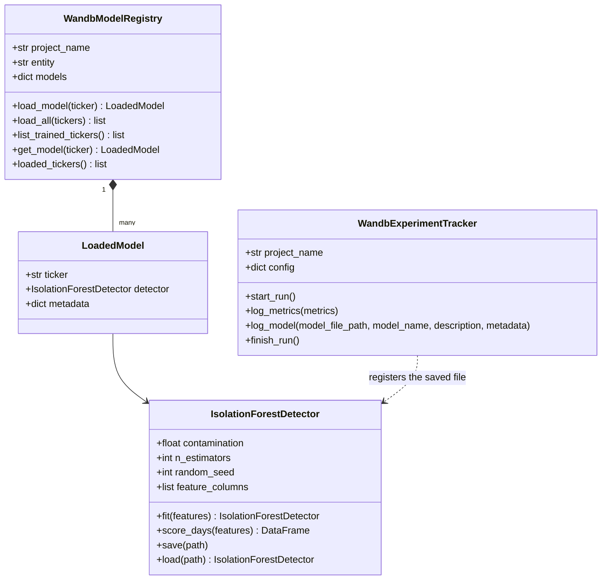

Each training run saves the detector as a plain dictionary (the sklearn model
and its settings), so any environment can read it. The artifact is named
`outlier-detector-<ticker>`, with the ticker in lower case. Its metadata has
the training configuration, `training_rows`, `walk_forward_rows`,
`walk_forward_flagged_share`, `feature_columns` and `trained_at`.

## API

| Method | Route | Description |
|---|---|---|
| GET | `/docs` | Interactive documentation (Swagger UI) |
| GET | `/health` | Service status and number of models in memory |
| GET | `/models` | Tickers with a model in memory |
| POST | `/predict` | Scores the most recent days of a ticker |

### `POST /predict`

Request body:

```json
{
  "ticker": "AAPL",
  "last_n_days": 5
}
```

- `ticker`: 1 to 20 characters from letters, digits, `^`, `=`, `.`, `_` and `-`.
- `last_n_days`: from 1 to 60, default 5.

Response (200):

```json
{
  "ticker": "AAPL",
  "model_trained_at": "2026-11-16T01:14:31.387232+00:00",
  "days": [
    {"day": "2026-11-13", "score": 0.352252, "is_atypical": false}
  ]
}
```

- `score`: higher means more atypical. It is the negative of the Isolation
  Forest `score_samples`.
- `is_atypical`: `true` when the model classifies the day as an outlier. The
  threshold comes from the `contamination` used in training (0.1).

Errors:

| Status | Cause |
|---|---|
| 404 | No model in memory for the ticker |
| 422 | The market data does not give any feature row |
| 422 | The request does not match the schema (for example, an unsafe ticker) |

The features of a day are computed from the last 365 days of market data. The
`last_n_days` parameter only selects which of those scored days are returned.

## Configuration

### GitHub

| Name | Kind | Used by | Purpose |
|---|---|---|---|
| `WANDB_API_KEY` | Secret | Train | Registers the models in W&B |
| `VERCEL_TOKEN` | Secret | Deploy | Token for `vercel deploy` |
| `VERCEL_ORG_ID` | Secret | Deploy | Team or account id (`orgId` in `.vercel/project.json`) |
| `VERCEL_PROJECT_ID` | Secret | Deploy | Project id (`projectId` in `.vercel/project.json`) |
| `DEPLOY_ENVIRONMENT` | Variable (optional) | Deploy | GitHub environment, `production` by default |

### Vercel (Production environment)

| Name | Required | Purpose |
|---|---|---|
| `WANDB_API_KEY` | Yes | Downloads the models from W&B at startup |
| `OUTLIER_TICKERS` | No | Tickers loaded at startup, for example `AAPL,GOOGL,MSFT`. Empty means discovery in W&B |
| `WANDB_ENTITY` | No | W&B user or team. Default: the account of the key |
| `OUTLIER_WANDB_PROJECT` | No | W&B project. Default: `outlier-detector` |

The application creates the W&B configuration, cache and data folders in a
temporary folder, because the home folder of a Vercel function is read-only.

### Local `.env`

Copy `.env.example` to `.env` and fill `WANDB_API_KEY`. Never commit `.env`.
Set `WANDB_MODE=disabled` to run the notebook or the training without sending
anything to W&B.

## Running locally

Requirements: [uv](https://docs.astral.sh/uv/) and a W&B key.

```bash
uv sync --extra dev                       # dependencies and test tools
uv sync --extra dev --extra notebook      # also matplotlib and ipykernel

uv run pytest                             # unit tests, no network
uv run pylint src                         # lint of the package

uv run python -m outlier_detector.training.train --tickers AAPL,GOOGL
```

Training options: `--start` (default `2020-01-01`), `--benchmark` (default
`^BVSP`), `--contamination` (default `0.1`), `--n-estimators` (default `300`),
`--random-seed` (default `42`), `--train-min` (default `756`), `--step` (default
`126`) and `--wandb-project` (default `outlier-detector`).

Run the API:

```bash
OUTLIER_TICKERS=AAPL uv run uvicorn api.index:app --reload
```

Then open `http://127.0.0.1:8000/docs`.

The notebook `notebooks/outlier_detection_simple.ipynb` runs the same training
steps from top to bottom, without functions or classes, and saves the model in
the format the package reads.

## Repository layout

```
api/index.py                          Vercel entry point, exposes the FastAPI app
vercel.json                           function settings and rewrite of every route
requirements.txt                      runtime dependencies, exported from uv.lock
pyproject.toml, uv.lock               project dependencies (uv) and extras dev, notebook
notebooks/outlier_detection_simple.ipynb   teaching notebook of the training
src/outlier_detector/
  data/market_data.py                 prices, benchmark and earnings dates (yfinance)
  features/price_features.py          the 7 feature columns and build_features
  models/isolation_forest_detector.py IsolationForestDetector: fit, score_days, save, load
  models/walk_forward.py              walk-forward scores without future data
  tracking/wandb_tracker.py           W&B run, metrics and artifact registration
  registry/wandb_model_store.py       artifact name, upload and download
  training/train.py                   training command, one W&B run per ticker
  serving/model_registry.py           WandbModelRegistry: models in memory from W&B
  serving/service.py                  market data download and scoring of the last days
  serving/schemas.py                  request and response models
  serving/api.py                      routes, startup loading and request logging
  serving/vercel.py                   path restoration for the Vercel rewrite
tests/outlier_detector/               tests mirroring src, no network
.github/workflows/                    CI, Train and Deploy workflows
```

## Maintenance

- **Dependencies:** after changing `pyproject.toml`, run `uv lock` and
  `uv export --no-dev --no-hashes --no-emit-project --frozen -o requirements.txt`.
  The CI fails when `requirements.txt` does not match `uv.lock`.
- **Tests:** the tests replace yfinance and the W&B client, so they run without
  the network and without `WANDB_API_KEY`.
- **Logs:** the startup logs the models loaded and the tickers requested. Each
  prediction logs its ticker, number of days, atypical count and duration.
  Rejected requests are logged as warnings.
- **Known limits:** the training fits the final model on all rows, so the
  `/predict` scores of recent days are in sample. Use the walk-forward metrics
  of the training run to evaluate the model honestly.
